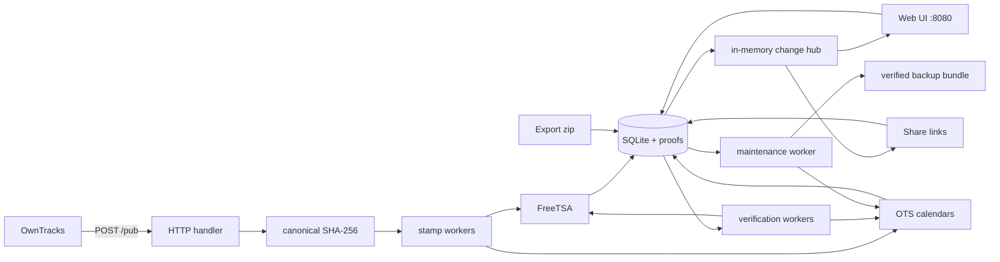

# mytracker

Proof-capable personal location tracker. Receives [OwnTracks](https://owntracks.org/) HTTP location updates, timestamps each point with external **RFC 3161 TSA** and **OpenTimestamps**, and provides a web UI for monitoring and verification.

Verify exported proof archives with the [standalone browser verifier](https://prepaser.github.io/mytracker).

## Features

- OwnTracks HTTP endpoint (`POST /pub`) with Basic Auth
- Optional OwnTracks MQTT subscriber (`owntracks/#`)
- Per-point TSA and Bitcoin-anchored OpenTimestamps proofs
- Web dashboard on port `8080` (login, stats, map, verify, settings)
- Public share links (read-only map for friends/family)
- Location export zip for submission (JSONL, CSV, proofs) — streamed, proof-scoped
- Import from export zip (skips duplicates, restores proofs)
- Durable stamp job queue with renewable leases, restart recovery, hot worker resize, and persistent retry state
- Durable proof verification queue with renewable leases, request coalescing, and restart recovery
- Durable maintenance scheduler for backups, retention, OTS upgrades, proof GC, and session cleanup
- Retention policy, webhook on stamp failure, Prometheus metrics
- Verified DB + proof backup bundles with automatic pruning and journaled restore
- Deterministic canonical hashing for reproducible verification
- Strict TSA trust policies and local Bitcoin header/PoW/confirmation checks
- Native TLS with PEM certificates or automatic ACME certificate management
- Persistent trips/stays timeline with configurable movement thresholds
- Circular geofences with enter/exit history and signed webhook delivery
- GPX 1.1 import/export through the web UI, API, and CLI

## Quick start

For a persistent Linux installation, follow the [deployment guide](deploy/README.md): systemd setup, native HTTPS or a reverse proxy, first login, and updates. See [Backups and recovery](docs/backups.md) for backup, verification, restore, and privacy maintenance procedures.

```bash
go build -o mytracker .
./mytracker
```

On first local start, deployment settings are written to `config.toml`, credentials and web settings are initialized in SQLite, and a mode-`0600` bootstrap password file is created:

```
config.toml                 # deployment settings, no credentials
data/mytracker.db            # web settings, credentials, and location data
.initial-password            # read and delete; also removed after the first successful login
```

The plaintext bootstrap password is written to `.initial-password` in the process working directory, independently of the config filename and `data_dir`. Read it and delete the file immediately. The first successful login also removes it. Never include this file in backups or version control. The supplied systemd unit uses `/var/lib/mytracker-bootstrap/.initial-password`, outside the data directory `/var/lib/mytracker`. The bootstrap directory persists across reboots; a successful restore removes its password file. Start the server outside `data_dir`; an existing bootstrap file is never overwritten. Existing `initial-password` and `data_dir/initial-password` files are moved to the new location on server startup, with conflicting files left untouched and reported as an error.

Interrupted initialization resumes only when `data_dir/.initial-password.pending` matches the data directory and bootstrap file hash. This temporary `0600` marker contains no plaintext password and is removed after settings commit. An unrelated existing password file is still rejected.

Open the web UI and go to **Settings** for the OwnTracks URL and TSA/OTS configuration. Settings and credentials persist across restarts; inspection and backup commands do not initialize credentials.

## OwnTracks app setup

1. Connection → Mode: **HTTP**
2. URL: copy from **Settings** in the web UI (includes Basic Auth)
   ```
   https://owntracks:<password>@tracker.example.com/pub
   ```
   Set `public_url` in config when behind a reverse proxy; see [Configuration](docs/configuration.md).
3. Optional: set username/device under **Identification** (sent as `X-Limit-U` / `X-Limit-D`)

See [OwnTracks HTTP docs](https://owntracks.org/booklet/tech/http/).

## How verification works

Each location's canonical SHA-256 digest receives a TSA timestamp and an OTS Bitcoin anchor. Background verification checks the proofs against the configured trust policy and records results for the UI.

See [TSA and OTS proofs](docs/proofs.md) for canonical hashing, trust roots, nonce/policy checks, Bitcoin confirmation, result meanings, and rechecks. The default provider requires [FreeTSA verification setup](docs/proofs.md#freetsa-verification-setup).

## Deployment

Follow the [deployment guide](deploy/README.md) for `install` commands, permissions, HTTPS setup, first login, and updates. Backup and restore procedures are in the [backup guide](docs/backups.md). The supplied systemd unit uses `/usr/local/bin/mytracker`, `/etc/mytracker/config.toml`, and `/var/lib/mytracker/`. Configuration is root-owned and read-only to the service (`root:mytracker`, `0640`); data directories are private to `mytracker` (`0700`).

systemd creates the data and bootstrap directories. Its working directory is `/var/lib/mytracker-bootstrap`, outside `data_dir`, so the one-time password is separate from data backups and persists until it is read and deleted or removed after login or restore.

## Configuration

`config.toml` contains deployment settings and requires a restart after changes. Credentials and runtime settings are managed through Settings and stored in SQLite; the web UI never writes TOML.

See [Configuration](docs/configuration.md) for deployment keys, defaults, validation, environment overrides, and web settings. HTTPS and reverse proxy examples are in the [deployment guide](deploy/README.md#2-choose-https-mode).

## Data layout

```
data/
  acme/                 # automatic HTTPS certificate cache, when enabled
  mytracker.db          # locations, jobs, sessions, and verification history
  backups/              # local backup bundles
  proofs/               # mode 0700
    1.tsr               # RFC 3161 response
    1.ots               # OpenTimestamps proof
```

## Architecture



## Development

```bash
# unit tests (no network, includes -race in CI)
go test -short ./...

# all tests including FreeTSA integration
go test ./...

# build
go build -o mytracker .

# browser smoke and accessibility tests
(cd e2e && npm ci && npx playwright install chromium && npm test)

# complete local quality gate
make check

# operational commands
./mytracker doctor
```

### Project layout

```
main.go
deploy/           # systemd deployment files
docs/             # proof, transfer, backup, and runtime guides
internal/
  app/            # CLI commands, locks, doctor, and server lifecycle
  canonical/      # deterministic record hashing
  config/         # TOML config + Manager
  export/         # location submission zip
  importzip/      # import from export zip
  geojson/        # track GeoJSON (admin + share)
  track/          # bounded trajectory sampling
  maintenance/    # durable periodic and manual operations
  metrics/        # Prometheus metrics
  mqtt/           # OwnTracks MQTT subscriber
  owntracks/      # /pub HTTP + shared ingest
  ratelimit/      # per-IP rate limiting
  retention/      # backed-up retention operation
  slogx/          # structured logging init
  stamp/          # TSA + OTS pipeline (worker pool)
  store/          # SQLite
  tsa/            # RFC 3161 client
  ots/            # OpenTimestamps client
  webhook/        # stamp failure webhooks
  web/            # dashboard + API + templates
  worker/         # shared wake, heartbeat, lease, and shutdown primitives
  testutil/       # shared test setup
```

Core packages do not import `internal/web` or `internal/app`; the local quality gate checks this dependency direction. Durable queue state transitions remain owned by their domain services, while `internal/worker` only provides lifecycle primitives.

`make check` runs the short race suite, static analysis, vulnerability and coverage gates, dependency-direction check, and Playwright smoke tests. Coverage includes cross-package execution from the existing unit and integration tests; package gates use the same combined profile. Live ACME issuance, MQTT brokers, and public TSA/Esplora availability remain deployment checks; `make test-integration` exercises the opt-in TSA test.

## License

mytracker is licensed under the GNU Affero General Public License v3.0 only (`AGPL-3.0-only`). See [LICENSE](LICENSE) for the full terms. Third-party dependencies and bundled assets retain their respective licenses.

Source code: [github.com/prepaser/mytracker](https://github.com/prepaser/mytracker). Bundled [Leaflet](internal/web/static/leaflet/LICENSE) and [Lucide](internal/web/static/vendor/lucide/LICENSE) include their original license notices.